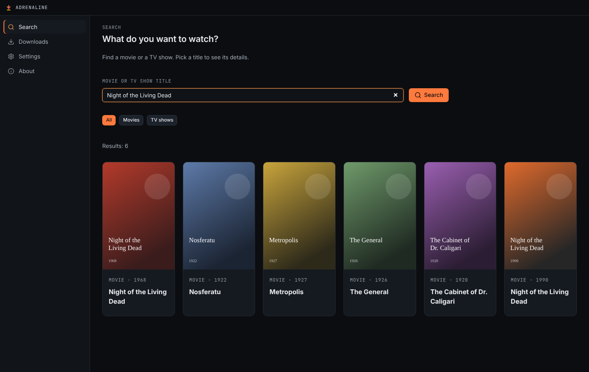
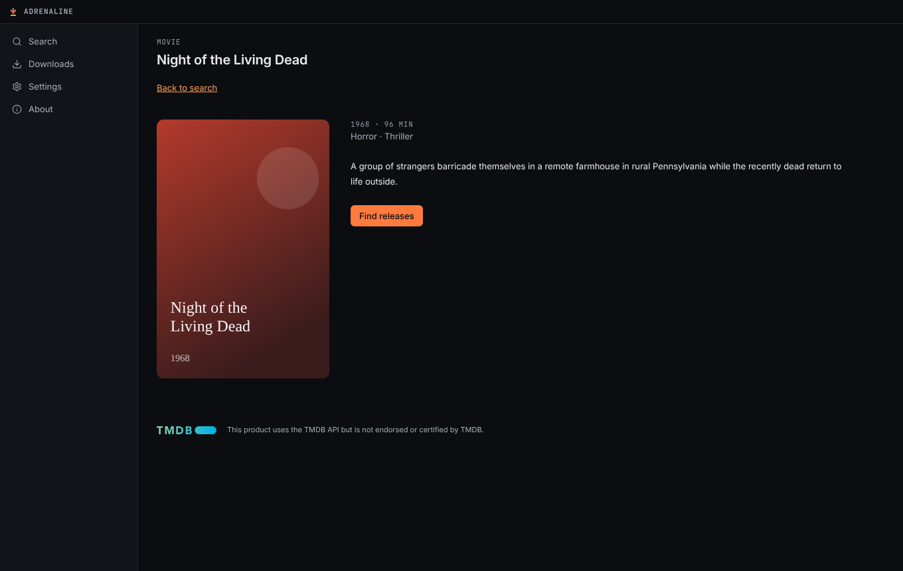
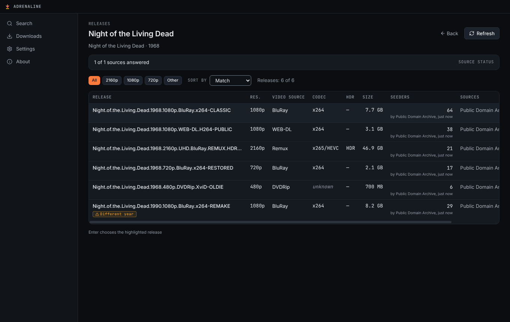
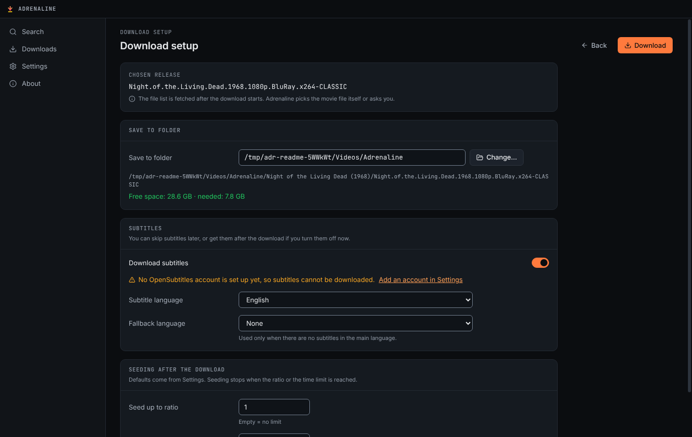
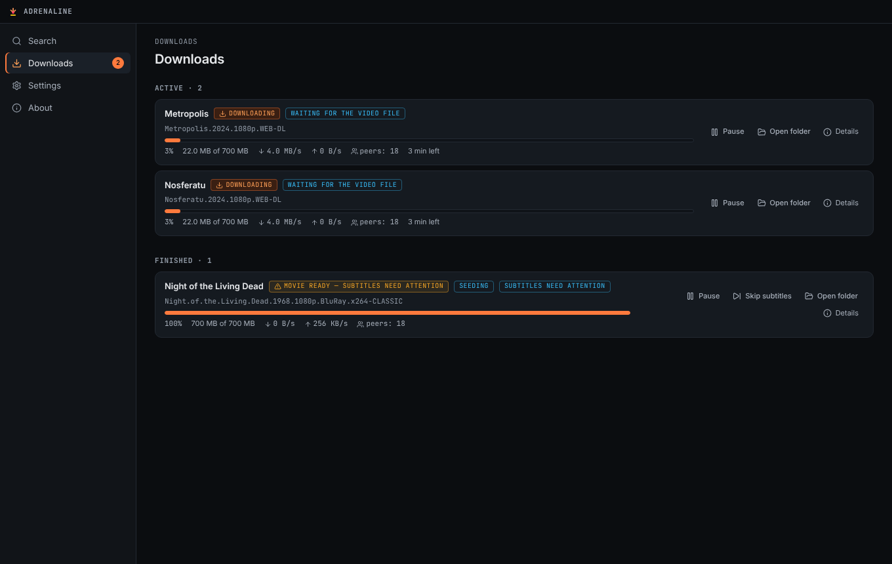
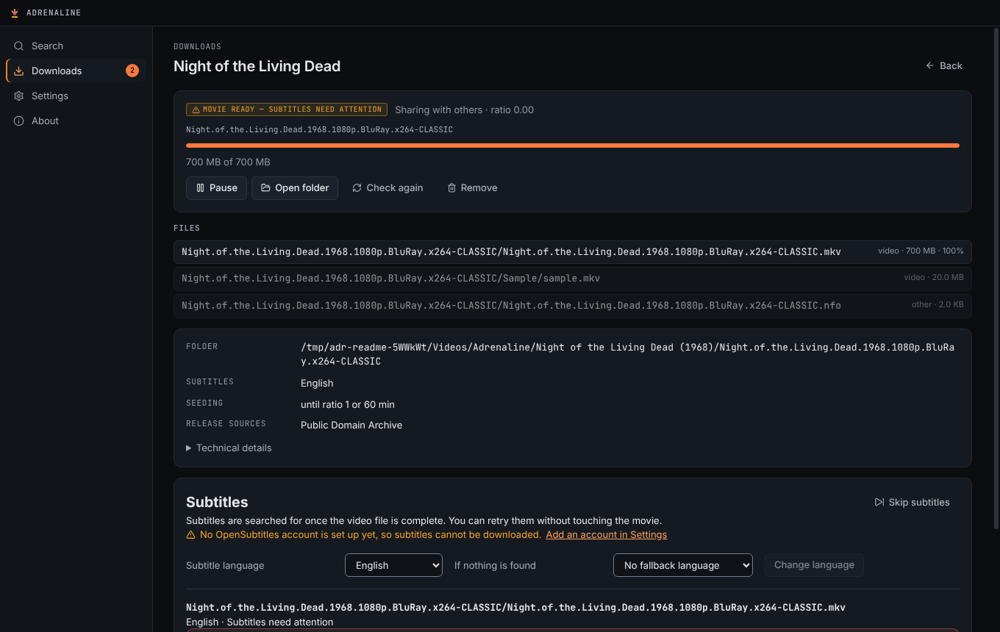
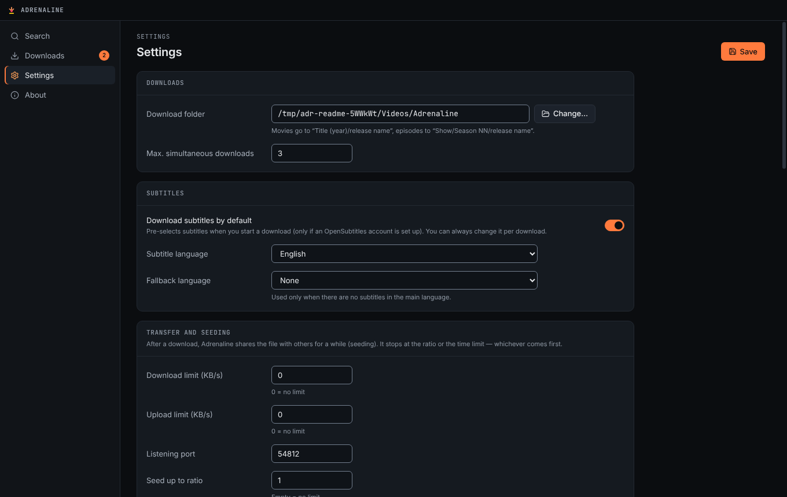

<p align="center">
  <picture>
    <source media="(prefers-color-scheme: dark)" srcset="src/renderer/assets/brand/adrenaline-logo-on-dark.svg">
    
  </picture>
</p>

<p align="center">
  <strong>Find a movie or an episode, pick a release, click Download — and open a folder with the movie and its subtitles.</strong>
</p>

<p align="center">
  <a href="https://github.com/JakubKonkol/Adrenaline/releases/latest"></a>
  
  
  
</p>

<p align="center">
  
</p>

Adrenaline is a Windows desktop app that takes you from “I want to watch this” to a ready folder in a few clicks. It searches the [TMDB](https://www.themoviedb.org/) catalog, looks for releases across several sources at once, downloads the one you pick with a built-in engine, and — if you want — saves matching subtitles from [OpenSubtitles.com](https://www.opensubtitles.com/) right next to the video.

No separate torrent client, no .NET install, no browser tabs. Everything runs locally on your machine.

> [!IMPORTANT]
> Adrenaline is a tool. Only download content you have the rights to — public-domain films, Creative Commons works, your own material, and so on.

## Features

- **One catalog for movies and TV shows.** Search TMDB, compare remakes by year, browse seasons and pick a single episode.
- **Releases from many sources at once.** A bundled [Jackett](https://github.com/Jackett/Jackett) service queries public indexers over Torznab; you can add your own Torznab endpoints too. Results are merged by info hash, ranked by how well they match your title, and arrive as each source answers — one slow or broken source never hides the others.
- **Clear release comparison.** Resolution, video source, codec, HDR, size, seeders and a match score with warnings such as *Different year*, *Season pack* or *Recorded in a cinema*.
- **Built-in download engine.** A small native helper on top of [libtorrent](https://libtorrent.org/) downloads only the files you need (the movie, not the samples), pauses and resumes for real, survives app restarts and crashes, and handles full disks or disconnected drives.
- **Subtitles when you want them.** Choose per download whether to fetch subtitles. Skip them at any time, or get them later. Matching uses the file hash first, so subtitles fit the exact release. Existing subtitle files are never overwritten.
- **Sensible seeding.** Shares the file back for a while after downloading and stops at a ratio or time limit you choose.
- **Quiet in the background.** Keeps downloading from the system tray, shows speeds in the tray tooltip, and updates itself from GitHub Releases.
- **Private by design.** No telemetry. Keys are encrypted with the Windows credential store, and “Copy diagnostics” never includes titles, paths or secrets.

## Screenshots

| Pick a title | Compare releases |
|---|---|
|  |  |
| **Decide on subtitles** | **Watch progress** |
|  |  |
| **Download details** | **Settings** |
|  |  |

<sub>Screenshots use public-domain films and generated posters (`scripts/dev/readme-screenshots.mjs`).</sub>

## Getting started

1. Download `Adrenaline-Setup-<version>.exe` from the [latest release](https://github.com/JakubKonkol/Adrenaline/releases/latest) and run it. No administrator rights are needed.
2. The setup wizard asks for a download folder, a subtitle language, and your **TMDB key** — get one for free at [themoviedb.org](https://www.themoviedb.org/settings/api).
3. Turn on the release sources you want to use.
4. *(Optional)* For subtitles, add an [OpenSubtitles.com](https://www.opensubtitles.com/en/consumers) API key and your account in **Settings → Accounts and keys**.
5. Search for a title, choose a release, decide on subtitles and click **Download**.

Movies are saved as `Title (year)/<release>/…` and episodes as `Show/Season NN/<release>/…`, with subtitles next to the video (e.g. `Movie.en.srt`).

The [user guide](docs/user-guide.md) (also available in the app under **About**) explains sources, seeding, subtitle states and where your data lives.

## How it works

```
┌──────────────── Electron app ─────────────────┐
│ Renderer (React, sandboxed, no Node access)   │
│          │ narrow, validated IPC              │
│ Main process: catalog · sources · downloads · │
│ subtitles · SQLite (node:sqlite) · updater    │
└───┬──────────────┬──────────────────┬─────────┘
    │ JSON Lines   │ HTTP (loopback)  │ HTTPS
    ▼              ▼                  ▼
adrenaline-engine  Jackett          TMDB, OpenSubtitles,
(C++, libtorrent)  (Torznab)        GitHub Releases
```

- **`src/renderer`** — React UI. Context isolation, sandbox and a strict CSP; it never sees secrets, the file system or download links.
- **`src/main`** — app lifecycle, validated IPC, services, HTTP providers, SQLite, the engine client, the Jackett manager and the updater.
- **`src/shared`** — domain logic and Zod contracts shared by both sides.
- **`native/engine`** — `adrenaline-engine`, a libtorrent helper speaking a JSON Lines protocol over stdin/stdout.

## Development

Requirements: Node 24 (see `.nvmrc`) and npm 11. The app targets Windows x64, but everything except the installer can be developed and tested on Linux.

```bash
npm ci                                  # install
ADRENALINE_FAKE_ENGINE=1 npm run dev    # run with a simulated engine (no C++ build needed)
npm run check                           # lint + typecheck + unit tests
npm run build && npm run test:smoke     # Playwright smoke test (Linux: xvfb-run -a npm run test:smoke)
```

The native engine (`native/engine`) builds with CMake: `cmake --preset linux-system && cmake --build --preset linux-system` on Linux (system libtorrent), or the `windows-release` preset with vcpkg on Windows. `ADRENALINE_ENGINE_PATH=<binary> npm run test:engine` runs the local swarm test.

More in [docs/dev-setup.md](docs/dev-setup.md). Tests never touch the internet: catalog, source and subtitle tests run on synthetic fixtures, and the engine is tested on a local swarm with generated data.

### Releases

Releases are built only by GitHub Actions. `npm version <patch|minor|major> -m "Release v%s"` followed by `git push origin main --follow-tags` runs the tests, builds the engine on Windows, bundles Jackett, packages the NSIS installer and publishes a GitHub Release, which installed apps pick up through `electron-updater`.

## Credits

- Movie and TV data by [TMDB](https://www.themoviedb.org/). *This product uses the TMDB API but is not endorsed or certified by TMDB.*
- Subtitles by [OpenSubtitles.com](https://www.opensubtitles.com/).
- Release search by [Jackett](https://github.com/Jackett/Jackett) (GPL-2.0, shipped unmodified as a separate program).
- Downloads by [libtorrent](https://libtorrent.org/) (BSD-3-Clause).
- Full third-party notices: [resources/licenses](resources/licenses).

© 2026 Jakub Konkol. All rights reserved.
