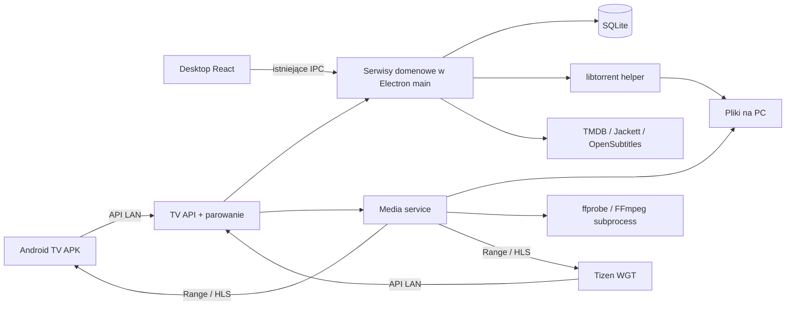

# Architektura, API i odtwarzanie

Wszystkie nazwy nowych modułów, endpointy i limity w tym dokumencie są **propozycją implementacyjną**. Źródła wyborów platformowych: [research](01-research.md).

## Co faktycznie istnieje w 0.9.0

| Miejsce | Obecna odpowiedzialność | Zmiana planowana |
| --- | --- | --- |
| `src/main/index.ts` | Tworzy serwisy, IPC, lifecycle, silnik i Jackett | Wyodrębnić composition root serwisów, podłączyć opcjonalny serwer TV |
| `src/main/services/catalog-service.ts` | TMDB, cache i zapis wybranego medium | Wspólna instancja dla IPC i API |
| `src/main/services/release-search-service.ts` | Sesje w pamięci, częściowe wyniki, zachowane ostatnie 10 sesji | Właściciel sesji, TTL, limit per klient i globalny; TV nie wypiera sesji desktopu |
| `src/main/services/download-service.ts` | Preflight, folder, pobranie, kolejka, stan i zdarzenia | Wspólna instancja; kontrola konkurencji i adapter uprawnień zdalnych |
| `src/main/services/subtitle-service.ts` | Napisy i zdarzenia zadań | Bez zmian zasad D-78; zdalne operacje przez ograniczone API |
| `src/main/ipc/*`, `src/preload`, `src/shared/contracts/*` | Walidowane lokalne API Electron | Zachować; nie zamieniać IPC na HTTP |
| `src/main/events.ts` | Wysyłanie zdarzeń tylko do `BrowserWindow` | Dodać niezależne subskrypcje API z redakcją DTO |
| `src/main/persistence/db.ts`, `migrations/001_init.sql` | SQLite WAL, wersjonowane migracje i backup | Migracje urządzeń i metadanych odtwarzania |
| `src/main/fs/safe-path.ts` | Bezpieczne operacje ścieżek | Wykorzystać, rozszerzyć testy rzeczywistej ścieżki/reparse point |
| `src/renderer/routes.tsx`, `Layout.tsx` | Nawigacja desktopu | Dodać `/tv`, pozostawić istniejące trasy |
| `electron-builder.yml`, `.github/workflows/release.yml` | NSIS i aktualizacje Windows | Dołączyć artefakty TV i manifest wersji |

Nie ma obecnie playera ani serwera LAN. „Biblioteka” opiera się na zapisanych mediach i pobraniach (`download_jobs`, `download_files`), nie na pełnym skanerze dysków. W 1.0 TV Library będzie projekcją gotowych plików z istniejących pobrań. Nie przepisujemy desktopowej listy Downloads ani nie dodajemy automatycznego importu całego dysku.

## Granice procesów

Jedna kolejka i jeden zapisujący właściciel bazy. Serwer API początkowo w main, asynchroniczne I/O, limitowane payloady; ffprobe/FFmpeg jako osobne procesy. Nie wykonujemy synchronicznego skanowania plików ani kodowania w event loop Electron. Przeniesienie transportu do `utilityProcess` dopiero po pomiarze, bez drugiego niezależnego właściciela domeny.

Serwer wyłączony domyślnie. `TV → Enable TV server` wybiera interfejs LAN i port (propozycja 18790; sprawdzić zajętość). Nie zmieniamy portu torrentowego ani bindu Jackett na loopback. Ustawienia serwera nie mogą blokować startu desktopu po awarii portu. DHCP: trwały `serverId`, edytowalny adres, diagnostyka interfejsów; discovery opcjonalne i bez sekretów. IP telewizora służy deploy, a **IP komputera** połączeniu aplikacji TV — UI pokazuje je oddzielnie.

Lifecycle: przy Quit/update przestać przyjmować mutacje, wysłać `serverStopping`, zamknąć sesje playerów i FFmpeg, zapisać postęp, potem dotychczasowy shutdown silnika/Jackett/DB. Zamykanie okna respektuje obecne `closeToTray`. Tryb serwera nie zmienia go po cichu. Opcjonalna blokada automatycznego usypiania tylko podczas aktywnego odtwarzania, z ustawieniem użytkownika; po wybudzeniu odnowić adres i sesje.

## Kontrakty i wieloklientowość

Nowe DTO w `src/shared/contracts/tv/*`, oddzielone od pełnych DTO IPC. Obecny `DownloadJob` zawiera `saveDir`, hashe i ścieżki napisów — nie wysyłamy go bezpośrednio do sieci. API pokazuje nazwy, stan, rozmiar i nieprzezroczyste `jobId/fileId`. Nie przyjmuje ścieżki Windows, URL torrenta ani magnetu od TV: klient wybiera zweryfikowaną parę `sessionId/releaseId`, folder wybiera serwer. Uprawnienia do konfiguracji dostawców, sekretów, otwierania folderów, restartu silnika i deploy pozostają lokalne.

Proponowany kontrakt `/api/v1`, JSON UTF-8, czas UTC, błędy `{code, requestId, retryable}` bez stack trace i ścieżek. Zod w runtime; generowany OpenAPI i DTO Kotlin sprawdzane na wspólnych fixtures, bez ręcznie rozjeżdżających się schematów. API version jest niezależne od wersji aplikacji.

| Endpoint | Odpowiedzialność i uprawnienia |
| --- | --- |
| `GET /api/v1/info` | Minimalne `serverId`, zakres wersji API, tryb transportu; brak biblioteki i sekretów |
| `POST /api/v1/pairings` | Tylko w oknie parowania włączonym na PC; zwraca ID, kod porównawczy, expiry i losowy sekret odbioru |
| `POST /api/v1/pairings/{id}/claim` | Polling z sekretem odbioru; token dopiero po akceptacji w lokalnym UI |
| `GET /api/v1/catalog/search`, `/catalog/{type}/{id}`, `/catalog/tv/{id}/seasons/{n}` | Katalog i szczegóły przez istniejący serwis |
| `POST /api/v1/release-searches`, `GET/DELETE /release-searches/{id}` | Start, snapshot i anulowanie własnej sesji; częściowe wyniki |
| `POST /api/v1/downloads/preflight`, `POST /downloads` | Weryfikacja wyboru/duplikatu/miejsca, utworzenie na PC |
| `GET /api/v1/downloads`, `/downloads/{id}` | Wspólna kolejka i szczegóły, DTO bez lokalnych ścieżek |
| `POST /api/v1/downloads/{id}/actions` | Allowlista: pause/resume/selectFiles/retrySubtitles/skipSubtitles/getSubtitles; osobna walidacja każdej akcji |
| `DELETE /api/v1/downloads/{id}` | Usunięcie zadania; kasowanie danych tylko z dodatkowym nadanym na PC prawem i potwierdzeniem |
| `GET /api/v1/library`, `/library/{fileId}` | Stronicowana projekcja ukończonych, istniejących plików wideo |
| `POST /api/v1/playback/sessions` | Negocjacja profilu, audio, napisów i trybu; zwraca URL z krótkim biletem |
| `PUT /api/v1/playback/sessions/{id}/progress`, `DELETE /playback/sessions/{id}` | Pozycja i zakończenie, tylko własna sesja |
| `GET/HEAD /media/{ticket}/...` | Plik/manifest/segment/napisy ograniczone biletem do jednej sesji |
| `GET /api/v1/events` | Long polling z kursorem i autoryzacją, snapshot po utracie historii |

Long polling to prosty punkt startowy zgodny z ograniczonymi klientami. Zdarzenia: `releaseSearchUpdated`, `downloadChanged`, `downloadProgress`, `libraryChanged`, `serverStopping`. Numer sekwencji i bounded ring buffer; klient po reconnect pobiera snapshot. Aktualizacje postępu scalać co 500–1000 ms, nie tworzyć nieograniczonej kolejki dla wolnego TV. WebSocket/SSE można dodać po pomiarach; nie jest potrzebny do osiągnięcia celu.

Serwer przypisuje sesję wyszukiwania do urządzenia (desktop ma własną lokalną tożsamość). Globalne i per-device limity sesji/zapytań; wygasła sesja daje `SEARCH_EXPIRED`. Obecny limit ostatnich 10 wymaga zmiany: równoległe TV nie może unieważniać wyboru desktopu. Pobieranie po przerwaniu połączenia nadal działa na PC.

Mutacje mają `Idempotency-Key`, klucz związany z urządzeniem i hashem żądania; ten sam klucz/inne body → konflikt. Tworzenie zadań serializować dla tego samego infohash, zachować indeksy unikalne SQLite. Pauza/resume/remove wymagają weryfikacji bieżącego stanu; konflikt → odświeżenie, nie ciche nadpisanie. Nie utrzymywać transakcji SQLite podczas sieciowego pobierania metadanych.

## Parowanie i transport — bramka bezpieczeństwa

Domyślny model docelowy: HTTPS z tożsamością serwera, potwierdzenie na PC, losowy token urządzenia i odwoływanie dostępu. Kod widoczny na obu ekranach nie jest długotrwałym hasłem ani tokenem. Propozycja: 120 s na parowanie, maks. 5 nieudanych prób i limit globalny; token 256 bitów z CSPRNG, na serwerze tylko hash. Android przechowuje sekret z ochroną Keystore; dla Tizen P0 ustala realne możliwości storage, a uprawnienia tokena ograniczają skutki jego wycieku.

**Nie zakładamy, że samopodpisany certyfikat PC zadziała w fetch i AVPlay.** Android może używać przypiętej tożsamości po zaufanym bootstrapie; zmiana fingerprintu wymaga ponownego potwierdzenia. Dla Tizen sprawdzić zaufany certyfikat/nazwę DNS i zachowanie playera. Nie obchodzić błędów przez globalne `rejectUnauthorized=false` lub podobne wyjątki.

Jeśli na docelowym Tizen bezobsługowe HTTPS nie przejdzie P0, udokumentować wybór przed P2: (a) wymagany zaufany certyfikat i DNS, co zwiększa konfigurację; (b) jawnie włączany tryb HTTP **tylko zaufana prywatna LAN**, z ostrzeżeniem o braku poufności i ochrony przed aktywnym napastnikiem w sieci. Tryb HTTP nie może być automatycznym fallbackiem po błędzie TLS. Zatwierdzenie na PC, token i krótkie bilety nie naprawiają podatności transportu na podsłuch. To otwarta decyzja produktu, nie rozwiązany problem techniczny. Nie projektujemy własnego protokołu szyfrowania.

Wspólne zabezpieczenia obu trybów:

- API bind tylko na wybranym LAN; firewall dla aplikacji/portu na profilu Private i podsieci lokalnej. Bez UPnP/port forwarding. W publicznej sieci serwer nie startuje automatycznie.
- Allowlista Host przeciw DNS rebinding; ścisła polityka Origin/CORS. Origin Tizen ustalić na sprzęcie; `null` nigdy nie oznacza automatycznej autoryzacji. Bez uwierzytelniania cookie i bez wildcard CORS z credentials.
- Wszystkie dane i mutacje wymagają tokena; nie wystawiamy IPC jako ogólnego RPC. Walidacja wielkości body (propozycja 64 KiB), query, timeoutów i limitów per-device/global. Obrazy tylko z dozwolonych providerów, bez otwartego URL proxy.
- Tokeny, kody, bilety mediów, hasła podpisów, nagłówki i pełne ścieżki redagowane także w logach HTTP/procesów. Cofnięcie urządzenia kończy sesje, unieważnia bilety i dostęp do napisów/segmentów.
- `fileId → DB → dozwolony plik`: canonical path, kontrola traversal i Windows junction/symlink, otwarcie pliku i sprawdzenie uchwytu/stat. Brak dowolnego `path=`. Nie serwować sekretów, SQLite ani plików spoza zarejestrowanego pobrania.
- Cały czas obowiązuje izolacja Electron, sandbox, CSP i allowlista IPC. UI TV nie ładuje zdalnego kodu ani stron źródeł.

## Biblioteka i player

Plik gotowy do odtwarzania: wybrany plik wideo ukończony i zweryfikowany przez silnik, obecny na dysku, dostępny do odczytu. Nie uzależniać playback od zakończenia seedowania ani powodzenia opcjonalnych napisów. Plik usunięty poza aplikacją → `FILE_MISSING`, bez usuwania historii. Biblioteka nie wydaje pliku częściowego jako kompletnego.

Nowe tabele (kolejna numeracja migracji po sprawdzeniu bieżącego repo): `tv_devices`, `tv_idempotency`, `media_probe`, `playback_progress`. Ustawienia serwera w istniejącym settings, sekrety TLS/certyfikatów w safeStorage lub chronionych plikach, hashe tokenów w `tv_devices`. `media_probe` kluczowane przez job/file i rozmiar/mtime; unieważnianie po recheck. Sesje streamingu i bilety w pamięci, znikają po restarcie. Historia oglądania per urządzenie, jedna wspólna biblioteka. Migracja addytywna, backup i test istniejącej bazy 0.9.0; rollback aplikacji tylko po sprawdzeniu zgodności schematu lub przywróceniu backupu, bez kasowania filmów.

Algorytm `PlaybackPlanner`: `ffprobe` z timeoutem → profil klienta → preferencje → najtańszy obsługiwany wariant:

1. Direct play: oryginalny plik, poprawne `GET/HEAD`, MIME, `Content-Length`, `Accept-Ranges`, `206/Content-Range`, `416`; strumień z backpressure, bez ładowania filmu do RAM. Jedna zakresowa odpowiedź wystarczy; wielozakresowe żądania mają jawnie zdefiniowane zachowanie.
2. Remux: wideo/audio pozostają, kontener/HLS dopasowane do klienta. Seek uruchamia właściwą pozycję i nową sesję segmentów.
3. Audio transcode: kopiowanie wideo i konwersja nieobsługiwanego audio do AAC stereo, jeśli profil na to pozwala.
4. Video transcode: kontrolowany fallback H.264/AAC do 1080p SDR, limit jednego równoległego kodowania na start. Jeśli PC nie utrzymuje czasu rzeczywistego, czytelny błąd lub niższy profil. 4K/HDR direct play wyłącznie po potwierdzeniu możliwości; nie obiecujemy tone mappingu.

FFmpeg/ffprobe to przypięte i zweryfikowane binaria Windows, osobne procesy bez shell, argumenty z allowlisty. Cache w userData z limitem miejsca, TTL i sprzątaniem po restarcie; przerwanie sesji kończy proces, także potomne. Limity CPU/operacji i kolejka mają chronić pobieranie oraz UI. Opcjonalne GPU po osobnym prototypie sterowników; bez uzależniania bazowej akceptacji od GPU.

Napisy: SRT jako podstawowy profil, konwersja do WebVTT, jeśli wymaga tego klient. Dla ASS/SSA jawna polityka: tekst bez pełnego stylu lub burn-in wymagający transcode; obrazkowe napisy dopiero z obsługiwanym burn-in. W P0 sprawdzić zewnętrzne napisy AVPlay, synchronizację po seek i polskie znaki. Nie wstrzykiwać treści napisów jako HTML.

Bilety mediów są osobne od tokena API, ograniczone do urządzenia/sesji/pliku i krótkiego czasu. Wszystkie segmenty HLS i napisy podlegają tej samej autoryzacji. Odnawianie biletu podczas długiego filmu musi działać; nie wolno wygasić odtwarzania po kilku minutach. Nie polegać na niestandardowych nagłówkach AVPlay bez testu. URL z biletem może być pragmatycznym transportem dla playera, ale podlega redakcji i nie służy do ogólnego API.

Oba klienty: duże kafelki, widoczny fokus, przewidywalny D-pad, Back powraca do poprzedniej pozycji, klawiatura ekranowa, obsługa długich list, stan offline i retry. Ekrany: Pair/Connect, Search, Details/Season, Releases, Download options, Downloads, Library, Player, Connection. Aktualizacja postępu nie może kraść fokusu. Pilot wystarcza do kompletnego scenariusza.
